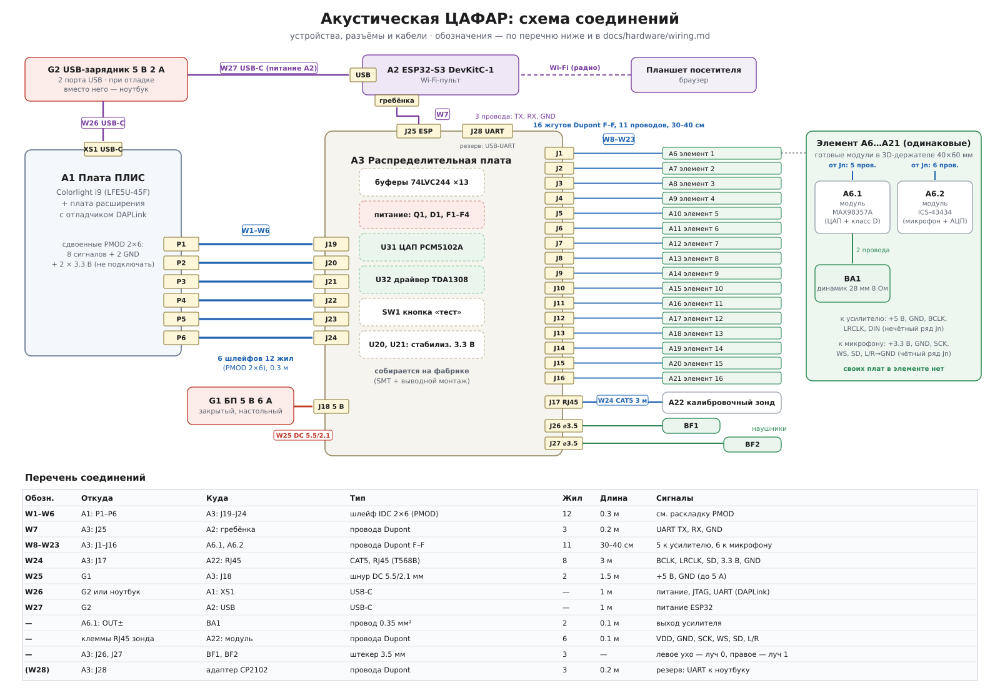

# Схема соединений

Уровень устройств: какие платы и модули есть в установке, какими разъёмами они
соединяются и какими кабелями. Внутреннее устройство плат — в [schematics.md](schematics.md),
функциональная (структурная) схема — в [architecture.md](architecture.md).

Исходник рисунка — `scripts/draw_wiring_diagram.py` (PNG для печати: `docs/img/wiring.png`).

## Перечень устройств

| Поз. | Наименование | Кол-во | Разъёмы |
|---|---|---|---|
| A1 | Плата ПЛИС: Colorlight i9 (LFE5U-45F) + плата расширения MuseLab с DAPLink | 1 | XS1 USB-C; P1–P6 — штыревые гребёнки 2×15 (P2, P3 используются) |
| A2 | ESP32-S3 DevKitC-1 (Wi‑Fi-пульт) | 1 | USB-C; штыревая гребёнка |
| A3 | Распределительная плата (своя, собирается фабрикой; на ней ЦАП PCM5102A и драйвер наушников TDA1308) | 1 | J1–J16 штыревые 2×6 (элементы); J17 RJ45 (зонд); J18 питание 5 В; J19, J20, J21 вилки IDC 2×15 (к P1, P2, P3 платы A1); J25 3 конт. (ESP32); J26, J27 гнёзда 3.5 мм (наушники); J29 RJ45 Ethernet (MagJack) |
| A6–A21 | Элемент решётки № 1–16 (в 3D-печатном держателе) | 16 | — |
| A6.1 … | готовый модуль усилителя MAX98357A | 16 | гребёнка: VIN, GND, BCLK, LRC, DIN; выход на динамик |
| A6.2 … | готовый модуль микрофона ICS-43434 | 16 | гребёнка: VDD, GND, SCK, WS, SD, L/R |
| BA1 … | Динамик 28 мм 8 Ом 2 Вт | 16 | 2 провода |
| A22 | Калибровочный зонд: готовый модуль ICS-43434 + готовый переходник RJ45 с винтовыми клеммами | 1 | XS1 RJ45 |
| G1 | Блок питания 5 В 6 А | 1 | штекер 5.5/2.1 мм |
| G2 | USB-зарядник 5 В 2 А, 2 порта (при отладке — ноутбук) | 1 | USB-A / USB-C |
| BF1, BF2 | Наушники | 2 | штекер 3.5 мм |

## Перечень кабелей

| Обозн. | Откуда | Куда | Тип | Жил | Длина | Сигналы |
|---|---|---|---|---|---|---|
| W1, W2 | A1: P2, P3 | A3: J20, J21 | шлейф IDC 2×15, прямой (контакт n → n) | 30 | 0.2 м | раскладка ниже |
| W3 | A1: P1 | A3: J19 | шлейф IDC 2×15, прямой, не длиннее 0.2 м | 30 | 0.15–0.2 м | пары MDI ETH1 (после PHY) → MagJack J29 |
| W29 | A3: J29 | коммутатор/ноутбук | патч-корд Ethernet | 8 | — | 100 Мбит надёжно, 1 Гбит — не гарантирован (шлейф) |
| W7 | A3: J25 | A2: гребёнка | провода Dupont | 3 | 0.2 м | UART TX, RX, GND |
| W8–W23 | A3: J1–J16 | A6.1, A6.2 элемента n | провода Dupont F–F (жгут) | 11 | 30–40 см | 5 проводов к усилителю, 6 к микрофону — [pinout.md](pinout.md) |
| W24 | A3: J17 | A22: XS1 | CAT5, RJ45 (T568B) | 8 | 3 м | BCLK, LRCLK, SD, 3.3 В, GND |
| W25 | G1 | A3: J18 | шнур DC 5.5/2.1 мм | 2 | 1.5 м | +5 В, GND (до 5 А) |
| W26 | G2 или ноутбук | A1: XS1 | USB-C | — | 1 м | питание A1; JTAG и UART через DAPLink |
| W27 | G2 | A2: USB | USB-C | — | 1 м | питание A2 |
| — | A6.1: OUT± | BA1 | провод 0.35 мм² | 2 | 0.1 м | выход усилителя |
| — | XS1 зонда (клеммы) | A22: модуль | провода Dupont | 6 | 0.1 м | VDD, GND, SCK, WS, SD, L/R |
| — | A3: J26, J27 | BF1, BF2 | штекер 3.5 мм | 3 | — | левое ухо — луч приёма 0, правое — луч 1 |

## Раскладка сигналов по шлейфам W1, W2 (IDC 2×15)

Нумерация контактов — как на гребёнках P2/P3 платы расширения: 1–15 в одном ряду, 16–30 в другом
(16 напротив 15, 30 напротив 1). На каждой гребёнке 1, 10, 21, 30 — 3V3, 2, 8, 11, 20, 29 — GND, 23 — 5V.
**Контакты 3V3 и 5V на распределительной плате не подключены** (у A3 свои стабилизаторы), земли
соединяются все. Направление — относительно ПЛИС. Полная таблица «контакт → шарик BGA» —
`gateware/i9_extboard_pins.json`.

| Контакт | 3 | 4 | 5 | 6 | 7 | 9 | 12 | 13 | 14 | 15 | 16 | 17 | 18 | 19 | 22 | 24 | 25 | 26 | 27 | 28 |
|---|---|---|---|---|---|---|---|---|---|---|---|---|---|---|---|---|---|---|---|---|
| W1: P2 → J20 | TXD0 → | TXD1 → | TXD2 → | TXD3 → | TXD4 → | TXD5 → | TXD6 → | TXD7 → | TXD8 → | TXD9 → | TXD10 → | TXD11 → | TXD12 → | TXD13 → | TXD14 → | TXD15 → | BCLK → | LRCLK → | MON_SD → | — (светодиод модуля) |
| W2: P3 → J21 | ← MIC0 | ← MIC1 | ← MIC2 | ← MIC3 | ← MIC4 | ← MIC5 | ← MIC6 | ← MIC7 | ← MIC8 | ← MIC9 | ← MIC10 | ← MIC11 | ← MIC12 | ← MIC13 | ← MIC14 | ← MIC15 | ← CAL | ← BTN_TEST | ← ESP_RX | ESP_TX → |

UART к ноутбуку (USB_TX/USB_RX) на распределительную плату не идёт: он уже выведен на USB-C
платы ПЛИС через DAPLink (гребёнка P5, контакты 15/16). Гребёнки P1, P4–P6 свободны — резерв
для плоской решётки 8 × 4.

На распределительной плате: BCLK, LRCLK — на буферы 74LVC244 U1–U8 (по одному корпусу на пару
элементов, свой выход на каждый модуль), TXD — на U9–U12 (по корпусу на 4 элемента); MIC0–15 — с
выходов тех же U9–U12 через 33 Ом; MON_SD — на
ЦАП U31 через U13; CAL — с разъёма J17 через U13; ESP_TX/ESP_RX — на J25 через 100 Ом;
BTN_TEST — кнопка SW1 на 3.3 В (подтяжка к земле включена в ПЛИС).

## Разъёмы распределительной платы для вспомогательных кабелей

| Разъём | Контакт | Сигнал | Примечание |
|---|---|---|---|
| J25 (к ESP32) | 1 | ESP_TX (ПЛИС → ESP32 RX) | на ESP32 — вывод RX UART1, например GPIO18; задаётся в прошивке пульта |
| | 2 | ESP_RX (ESP32 TX → ПЛИС) | на ESP32 — вывод TX UART1, например GPIO17 |
| | 3 | GND | |
| J18 | +, − | +5 В, GND | гнездо 5.5/2.1 мм, центр — «+» |

Раскладка проводов W8–W23 (разъём 2×6) и кабеля зонда W24 (RJ45) — в [pinout.md](pinout.md).

## Порядок подключения

1. Всё собрать и соединить **при выключенном питании**; ключи всех разъёмов IDC —
   в одну сторону.
2. Включить G2 (плата ПЛИС и ESP32), загрузить прошивку ПЛИС (`make prog`),
   проверить `dpaa_ctl.py id`.
3. Только после этого включить G1 (питание элементов). Выключать в обратном порядке.
