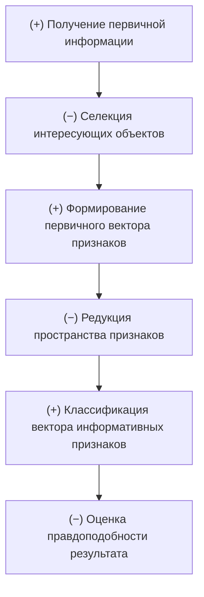
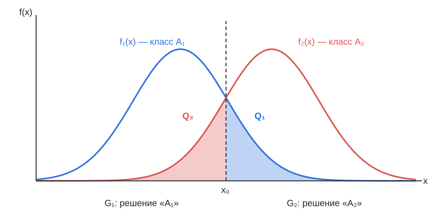
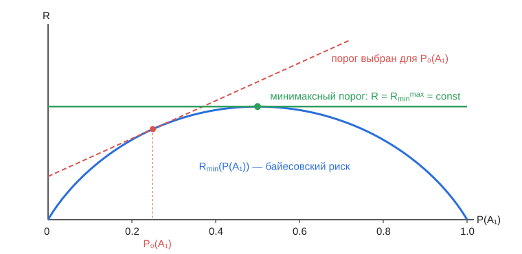
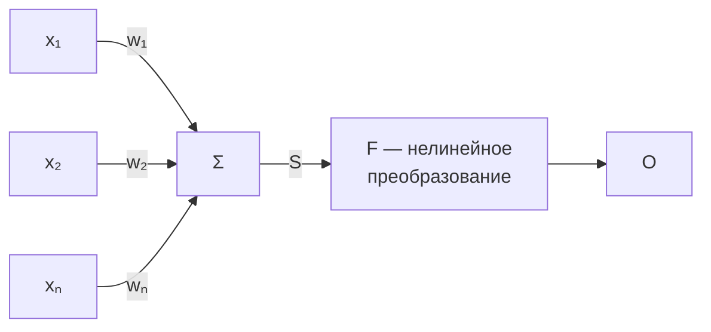
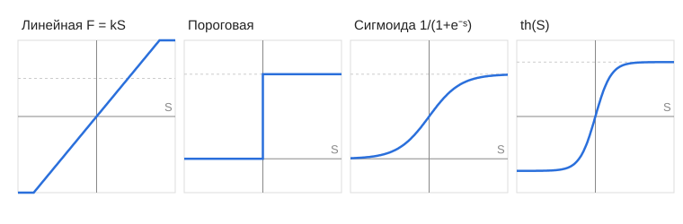
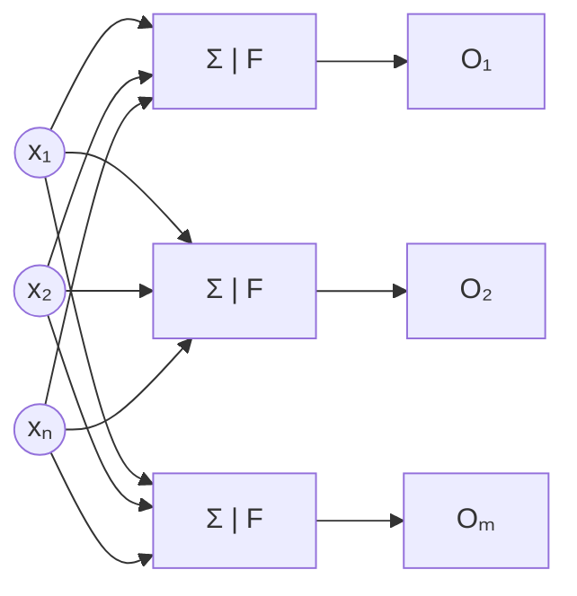
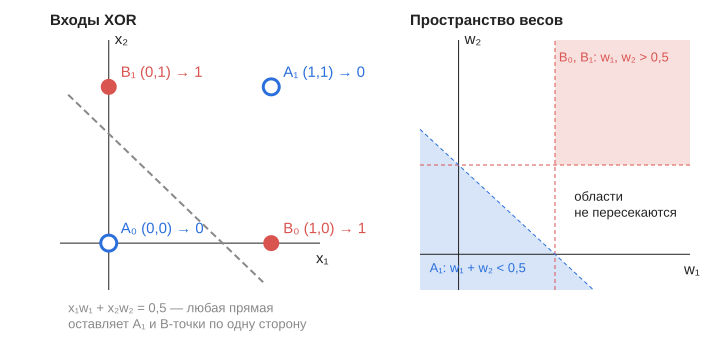
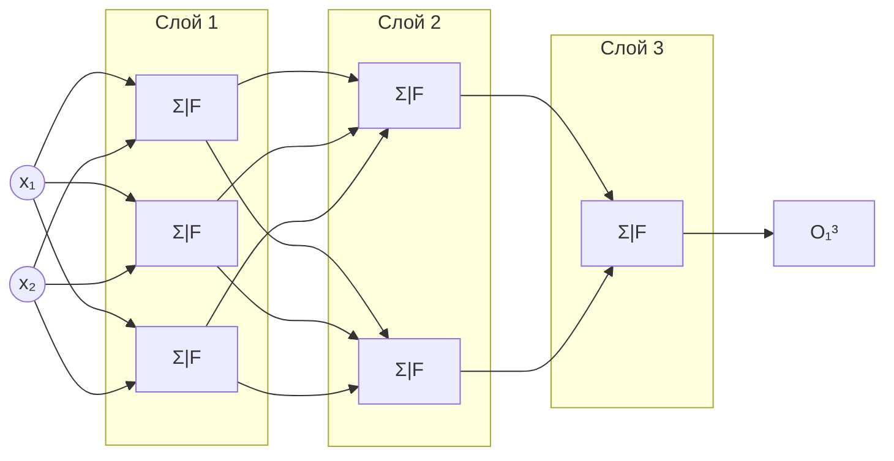
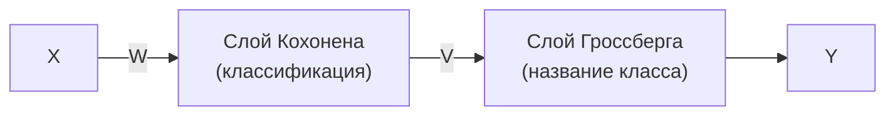
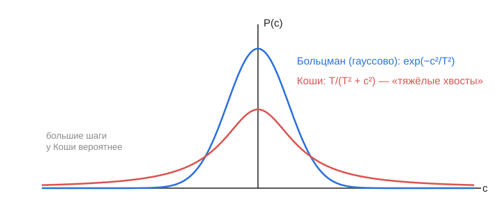

# ТРОИИ — конспект лекций

Преподаватель: Бурый Евгений Владиславович.

Конспект собран по рукописным записям и приведён в порядок: сокращения раскрыты,
формулы переписаны, пропущенные шаги выводов восстановлены, описки исправлены.
Добавленные мной пояснения вынесены в цитаты с пометкой **Пояснение**.
Места, которые в рукописи не удалось прочитать однозначно, помечены **[?]**.

* [Лекция 1 (03.03.26). Введение. Терминология. Признаки](#лекция-1-030326-введение-терминология-признаки)
* [Справка: функция распределения и плотность вероятности](#справка-функция-распределения-и-плотность-вероятности)
* [Лекция 2 (10.03.26). Теория статистических решений для построения классификатора](#лекция-2-100326-теория-статистических-решений-для-построения-классификатора)
* [Лекция 3 (17.03.26). Минимаксная стратегия. Алгоритмы классификации. Нейрон](#лекция-3-170326-минимаксная-стратегия-алгоритмы-классификации-нейрон)
* [Лекция 4 (24.03.26) и далее. Нейронные сети и их обучение](#лекция-4-240326-и-далее-нейронные-сети-и-их-обучение)
* [Краткая сводка](#краткая-сводка)

---

## Лекция 1 (03.03.26). Введение. Терминология. Признаки

### 1.1. Что такое ИИ

**Искусственный интеллект (ИИ)** — технология, имитирующая человеческое поведение,
чтобы выполнять задачи и обучаться. Это способность машины (системы) выполнять
действия, свойственные человеческому интеллекту.

* **Зачем?** — чтобы эффективно выполнять задачи.
* ИИ имитирует человека в задачах обработки информации (пример — опрос людей).

**Формальная постановка.** Есть вектор $X$ из параметров — свойств объектов.
Ему в соответствие ставится вектор $Y$, зависящий от управляемых [?] и неизвестных
входных параметров. Векторы $X$ и $Y$ однозначно связаны друг с другом, если между
ними есть функциональная зависимость $Y = F(X)$.

При этом возможна ситуация $Y = \text{const}$ при $X \ne \text{const}$: разным
векторам $X$ соответствует один и тот же $Y$.

> **Пояснение.** Именно это и есть суть распознавания: много разных наблюдений
> $X$ (один и тот же самолёт под разными ракурсами, с шумом и т. п.) должны быть
> отображены в один ответ $Y$ — номер класса.

### 1.2. Терминология

| Термин | Определение |
|---|---|
| **Распознавание** | Выделение характерных черт объекта; совокупность действий, производимых с целью получения интересующей информации об объекте исследования. |
| **Признак** | Характерная черта объекта. |
| **Словарь признаков** | Совокупность информативных признаков, определяющих объект. |
| **Вектор признаков** | Совокупность чисел, однозначно отличающая один объект от другого. |
| **Пространство признаков** | Пространство, в котором определены векторы признаков. |
| **Редукция пространства признаков** | Процедура, обеспечивающая уменьшение размерности пространства признаков. |
| **Образ** | Совокупность характеристик объекта, образующих вектор признаков, представляющий этот объект в информационном пространстве (пространстве признаков). |
| **Класс** | Совокупность объектов, имеющих некоторые общие свойства. |
| **Алфавит классов** | Определённым образом упорядоченное множество классов. |
| **Классификация** | Процедура, обеспечивающая отнесение исследуемого объекта к одному из классов. |
| **Кластер** (скопление, гроздь, рой) | Совокупность сходных объектов. |
| **Кластеризация** | Процедура разбиения объектов на группы (кластеры) так, что объекты разных групп сильно отличаются друг от друга. Кластеры не задаются заранее — в отличие от классов. |
| **Селекция** | Процедура выделения (интересующих объектов) из множества [?]. |
| **Качество распознавания** | Характеристика системы, отражающая её возможность работать в условиях шумов и помех. |
| **Устойчивость распознавания** | Сохранение работоспособности системы распознавания при изменении в определённых пределах параметров объектов и условий функционирования. |

### 1.3. Кластерный анализ

Дано множество объектов $X$ и множество номеров кластеров $Y$. Задаётся функция
расстояния между объектами $\rho(x, x')$, на основе которой обучающую выборку
нужно разбить на кластеры так, чтобы:

* каждый кластер состоял из объектов, **близких** по метрике $\rho$;
* объекты **разных** кластеров существенно различались.

**Области применения кластеризации:**

* маркетинг — сегментирование клиентов, конкурентов, исследование рынков;
* медицина — классификация симптомов, заболеваний, препаратов;
* биология — классификация живых организмов;
* социология — разбиение респондентов на однородные группы;
* компьютерный поиск — группировка результатов поиска сайтов, файлов.

Кластеризация особенно актуальна, если исходная выборка слишком большая: в
результате в каждом кластере можно оставить по одному типичному представителю
(сжатие данных).

### 1.4. Формирование образов объектов, их кластеризация и распознавание

**Пример.** Поставлена задача классификации типов летательных аппаратов (ЛА) в
соответствии с их принадлежностью и возможной опасностью для охраняемого объекта.

* **МиГ-31**, ракурс $\alpha = 0^\circ,\ \beta = 0^\circ$: измеряем признаки
  $1, 2, \dots, N$ и формируем вектор признаков **1.1**. При $\alpha = 10^\circ$
  получаем вектор **1.2**, при $\alpha = 20^\circ$ — вектор **1.3**.
  Набор векторов 1.1, 1.2, 1.3 составляет **образ 1**.
* **F-16**, аналогично: $\alpha = 0^\circ \to$ 2.1, $\alpha = 10^\circ \to$ 2.2,
  $\alpha = 20^\circ \to$ 2.3. Набор составляет **образ 2**.

Имеются априорные сведения, что в зоне ответственности всего могут появиться
15 типов ЛА. Образы формируются для каждого из них.

**Кластеризация** 15 типов:

| Типы ЛА | Кластер |
|---|---|
| 1 … 7 | истребители |
| 8, 9, 12 | бомбардировщики |
| 10, 11, 13 | транспортные [?] |
| 14, 15 | прочие |

Далее возможна **уточняющая кластеризация** внутри полученных групп.

Структурная схема системы:


**Не существует универсальной системы распознавания** — система строится под
конкретную задачу.

### 1.5. Функции классификатора

| № | Функция | Обязательность |
|---|---|---|
| 1 | Получение первичной информации об объекте | обязательно ( + ) |
| 2 | Селекция интересующих объектов | необязательно ( − ) |
| 3 | Формирование первичного вектора признаков | обязательно ( + ) |
| 4 | Редукция пространства признаков | необязательно ( − ) |
| 5 | Классификация вектора информативных признаков | обязательно ( + ) |
| 6 | Оценка правдоподобности результата | необязательно ( − ) |



### 1.6. Информативные признаки

**Виды признаков:**

1. **Физические** — наблюдаемые и измеряемые.
   *Пример:* длина $L$, ширина $W$, высота $H$, масса $m$.
2. **Структурные** — результат анализа совокупности физических признаков.
   *Пример:* форма (цилиндр или параллелепипед), цвет; для ЛА — скорость
   150–200 км/ч [?].
3. **Математические** — получаются в результате выполнения математических операций
   над рядом физических или структурных признаков.
   *Пример:* плотность $\rho = \dfrac{m}{L \cdot W \cdot H}$; множество отсчётов
   зарегистрированного сигнала (сигнатура) [?].

**Требования к признакам:**

* соответствие целевой задаче распознавания;
* индивидуальность — различие значений для разных объектов;
* инвариантность к условиям наблюдения;
* непрерывность (устойчивость) по отношению к условиям наблюдения.

**Проблема выбора признаков** заключается в сокращении числа признаков и
размерности пространства признаков без потери качества распознавания.

Признаки делятся на **главные** и **второстепенные** (частные, в т. ч. не присущие
объекту непосредственно). Физические признаки должны быть доступны для оценивания
в различных условиях наблюдения.

**Детерминированные и статистические признаки:**

* **Детерминированные** — непрерывные и логические (знаковые) [?]. Примеры:
  а) установлено, что форма — круг;
  б) установлено, что объект отличен от параллелепипеда.
* **Статистические** — получаются регистрацией параметров в моменты времени $t_i$
  и описываются вероятностными характеристиками.

---

## Справка: функция распределения и плотность вероятности

**Функция распределения** случайной величины $X$:

$$
F(x) = P(X < x), \qquad X \in (-\infty;\ x).
$$

Свойства:

* $F(-\infty) = 0$;
* $F(x)$ — неубывающая;
* $F(+\infty) = 1$.

**Функция плотности вероятности** $W(x)$ существует, если $F(x)$ дифференцируема:

$$
W(x) = \frac{dF(x)}{dx} \ge 0, \qquad
\int_{-\infty}^{+\infty} W(x)\,dx = 1 \quad \text{(условие нормировки)}.
$$

Вероятность попадания в интервал:

$$
P(x_1 \le X \le x_2) = F(x_2) - F(x_1) = \int_{x_1}^{x_2} W(x)\,dx.
$$

* Размерность $W(x)$ обратна размерности $X$.
* Зная $W(x)$, можно сказать, какие значения величины наиболее вероятны.

---

## Лекция 2 (10.03.26). Теория статистических решений для построения классификатора

### 2.1. Постановка задачи

* Имеется множество из $N$ объектов $\{\Omega_1, \dots, \Omega_N\}$.
* В соответствии с принципом деления они разбиты на классы $\{A_1, \dots, A_M\}$.
* Известны информативные признаки объектов $\{x_1, \dots, x_n\}$.
* Классы описаны априори через признаки:

$$
\begin{cases}
A_1 = F_1(x_1, \dots, x_n) \\
\quad\vdots \\
A_M = F_M(x_1, \dots, x_n)
\end{cases}
$$

**Нужно определить, к какому классу относится объект.**

Может быть принято $M + 1$ решение: $M$ решений «объект принадлежит классу $A_i$»
и ещё одно — **отказ**, когда объект не может быть отнесён ни к одному классу.

Из-за шумов и помех невозможно безошибочно определить параметры объектов,
поэтому **задача распознавания — вероятностная**.

### 2.2. Два класса, один признак

**Дано:** 2 объекта $(\Omega_1, \Omega_2)$, 2 класса $A_1$ и $A_2$;

* $f_1(x)$ и $f_2(x)$ — плотности вероятности появления признака $x$ у объектов
  классов $A_1$ и $A_2$;
* $P(A_1)$, $P(A_2)$ — априорные вероятности появления объектов каждого класса.

Порог $x_0$ делит пространство признаков на два подпространства: $G_1$ (решение
«$A_1$») и $G_2$ (решение «$A_2$»). Значение $x_0$ нужно выбрать так, чтобы
условные вероятности ошибок 1-го рода ($\Omega_1 \to A_2$) и 2-го рода
($\Omega_2 \to A_1$) были минимальны.



Вероятности ошибок и правильных решений:

$$
Q_1 = \int_{x_0}^{+\infty} f_1(x)\,dx, \qquad D_1 = 1 - Q_1;
$$

$$
Q_2 = \int_{-\infty}^{x_0} f_2(x)\,dx, \qquad D_2 = 1 - Q_2.
$$

Здесь $Q_1$ — вероятность ошибки 1-го рода, $Q_2$ — 2-го рода,
$D_1, D_2$ — вероятности правильного распознавания.

### 2.3. Матрица потерь и средний риск

**Матрица потерь** (строка — истинный класс, столбец — принятое решение):

$$
\|C\| =
\begin{bmatrix}
C_{11} & C_{12} \\
C_{21} & C_{22}
\end{bmatrix}
$$

* Элементы главной диагонали — нулевые или отрицательные: это потери при
  **правильных** решениях.
* Все остальные — потери при **ошибочных** решениях
  ($C_{12}$ — объект класса $A_1$ отнесён к $A_2$, $C_{21}$ — наоборот).

**Средний риск:**

$$
R(x_0) = P(A_1)\left(C_{11} D_1 + C_{12} Q_1\right) + P(A_2)\left(C_{22} D_2 + C_{21} Q_2\right).
$$

**Минимизация.** Учитывая, что
$\dfrac{dQ_1}{dx_0} = -f_1(x_0)$, $\dfrac{dD_1}{dx_0} = f_1(x_0)$,
$\dfrac{dQ_2}{dx_0} = f_2(x_0)$, $\dfrac{dD_2}{dx_0} = -f_2(x_0)$:

$$
\frac{dR}{dx_0} = P(A_1)\big(C_{11} f_1(x_0) - C_{12} f_1(x_0)\big) + P(A_2)\big(C_{21} f_2(x_0) - C_{22} f_2(x_0)\big) = 0.
$$

Отсюда

$$
\boxed{\;\lambda_0 = \frac{f_2(x_0)}{f_1(x_0)} = \frac{P(A_1)\,(C_{12} - C_{11})}{P(A_2)\,(C_{21} - C_{22})}\;}
$$

* $\lambda(x) = \dfrac{f_2(x)}{f_1(x)}$ — **отношение правдоподобия**;
* $\lambda_0 = \dfrac{P(A_1)}{P(A_2)} \cdot \dfrac{C_{12} - C_{11}}{C_{21} - C_{22}}$ — **порог**.

**Решающее правило:** если $\lambda(x) > \lambda_0$ — объект относится к классу $A_2$,
иначе — к классу $A_1$.

> **Пояснение.** Порог зависит только от априорных вероятностей и матрицы потерь.
> Если ошибка «пропустить $A_2$» дороже (растёт $C_{21}$), порог $\lambda_0$
> уменьшается и система чаще выдаёт решение «$A_2$».

### 2.4. Пример: два гауссовских класса

* $f_1(x), f_2(x)$ — нормальные плотности с матожиданиями $m_1$ и $m_2$;
* дисперсии равны: $\sigma_1^2 = \sigma_2^2 = \sigma^2$;
* $P(A_1) = P(A_2)$;
* $C_{11} = C_{22}$, $C_{12} = C_{21}$.

Тогда $\lambda_0 = 1$, т. е. порог — точка пересечения плотностей:

$$
x_0 = \frac{m_1 + m_2}{2}.
$$

Такая стратегия выбора порога называется **байесовской стратегией принятия решений**.

> **Пояснение (вывод).** $\lambda(x_0) = 1 \Rightarrow
> (x_0 - m_1)^2 = (x_0 - m_2)^2 \Rightarrow x_0 = \frac{m_1 + m_2}{2}$.

### 2.5. Общий случай: $M \ge 2$ классов, вектор признаков

Вектор признаков $X = \{x_1, \dots, x_n\}$, $f_k(X)$ — плотность распределения
$X$ для класса $A_k$.

**Отношения правдоподобия:**

$$
\lambda_{kl} = \frac{f_k(X)}{f_l(X)}, \qquad k = 1 \dots M,\quad l = 1 \dots M.
$$

**Матрица потерь** размером $M \times M$:

$$
\|C\| =
\begin{bmatrix}
C_{11} & \cdots & C_{1M} \\
\vdots & \ddots & \vdots \\
C_{M1} & \cdots & C_{MM}
\end{bmatrix}
$$

**Средний риск** ($G_k$ — область пространства признаков, в которой принимается
решение «класс $A_k$»):

$$
R = \sum_{k=1}^{M} \sum_{l=1}^{M} P(A_l)\, C_{lk} \int_{G_k} f_l(X)\,dX.
$$

> В рукописи индексы потерь записаны как $C_{kl}$; здесь они приведены к тому же
> соглашению, что и в п. 2.3: первый индекс — истинный класс, второй — принятое решение.

**Решающее условие минимизации среднего риска** (граница между областями $G_k$ и $G_l$):

$$
P(A_k)\, f_k(X)\,(C_{kl} - C_{kk}) - P(A_l)\, f_l(X)\,(C_{lk} - C_{ll}) = 0.
$$

**Простая (единичная) функция потерь:** $C_{kk} = C_{ll} = 0$, $C_{kl} = C_{lk} = 1$. Тогда

$$
P(A_k)\, f_k(X) - P(A_l)\, f_l(X) = 0
\quad\Longleftrightarrow\quad
\ln \frac{P(A_k)\, f_k(X)}{P(A_l)\, f_l(X)} = 0.
$$

> **Пояснение.** Отсюда решающее правило: объект относится к классу $A_k$, у которого
> произведение $P(A_k)\,f_k(X)$ максимально, т. е. максимальна апостериорная
> вероятность $P(A_k \mid X)$. При единичных потерях минимум среднего риска
> совпадает с минимумом вероятности ошибки. Логарифм удобен для гауссовских
> плотностей: экспоненты превращаются в квадратичные формы.

**Условия применимости.** Байесовский классификатор можно построить, если известны:

1. плотности распределения вероятности признаков $f_i(X) = f(X \mid A_i)$ для каждого класса;
2. априорные вероятности $P(A_i)$, $i = 1, 2, \dots, M$;
3. матрица потерь $\|C\|$.

---

## Лекция 3 (17.03.26). Минимаксная стратегия. Алгоритмы классификации. Нейрон

> В шапке страницы записано «Л3. Нейросетевые технологии»; первая половина лекции
> продолжает теорию статистических решений.

### 3.1. Гарантирующая (минимаксная) стратегия

Если априорные вероятности появления объектов каждого класса $P(A_i)$
**неизвестны**, используют **минимаксную стратегию**, гарантирующую определённое
значение среднего риска. Порог выбирают так, чтобы минимизировать риск при
**наихудших** значениях априорных вероятностей — тех, при которых риск максимален.

**Два класса.** $P(A_2) = 1 - P(A_1)$, $C_{11} = C_{22} = 0$, $C_{12}, C_{21} \ne 0$. Тогда

$$
R = P(A_1)\, C_{12} \int_{x_0}^{+\infty} f_1(x)\,dx + \big(1 - P(A_1)\big)\, C_{21} \int_{-\infty}^{x_0} f_2(x)\,dx
= P(A_1)\big(C_{12} Q_1 - C_{21} Q_2\big) + C_{21} Q_2 ,
$$

где $Q_1, Q_2$ — вероятности ошибок 1-го и 2-го рода при пороге $x_0$.

Если для каждого $P(A_1)$ брать оптимальный (байесовский) порог, получаем
минимальный риск $R_{\min} = f\big(P(A_1)\big)$. Отметим, что $R_{\min} = 0$ при
$P(A_1) = 0$ и при $P(A_1) = 1$, а между ними кривая выпукла вверх и имеет максимум
$R_{\min}^{\max}$ в точке $P_0(A_1)$.



* Если порог рассчитан для некоторого $P_0(A_1)$, а истинная вероятность $P(A_1)$
  другая, то риск меняется **по прямой** (касательной к кривой $R_{\min}$ в точке
  $P_0(A_1)$).
* Если взять $P_0(A_1)$ не в точке максимума, то на одном участке риск будет меньше
  $R_{\min}^{\max}$, а на другом — превысит его.
* **Минимаксный выбор:** $P_0(A_1)$ берут в точке максимума $R_{\min}$. Там касательная
  горизонтальна, т. е. риск **не зависит** от истинной $P(A_1)$ и всегда равен
  $R_{\min}^{\max}$. Условие:

$$
C_{12}\, Q_1(x_0) - C_{21}\, Q_2(x_0) = 0 .
$$

Пороговое значение отношения правдоподобия при этом

$$
\lambda_0 = \frac{C_{12}\, P_0(A_1)}{C_{21}\,\big(1 - P_0(A_1)\big)} .
$$

* При $C_{12} = C_{21}$ условие сводится к **равенству вероятностей ошибок 1-го и
  2-го рода**: $Q_1 = Q_2$.
* Решающее правило: $\Omega \in A_1$, если $x < x_0$; $\Omega \in A_2$, если $x \ge x_0$.

**Минимаксная стратегия — это стратегия Байеса для наихудших значений априорных
вероятностей.**

### 3.2. Алгоритмы классификации

Рассматривают, как правило, два случая: число классов **задано** и число классов
**неизвестно**.

**Задача:** распределить $N$ объектов по $M$ классам так, чтобы обеспечить экстремум
некоторого **критерия эффективности**.

Для оптимальной классификации нужно перебрать все возможные варианты разбиения, что
при больших $M$ и $N$ нереально. Поэтому сокращают число рассматриваемых
(неперспективных) вариантов и используют **итеративные алгоритмы**, в ходе которых
оценивается критерий эффективности разных вариантов разбиения на классы.

**Итеративный алгоритм (число классов задано):**

1. Определить начальное множество (алфавит) классов.
2. Вычислить значение исходного критерия эффективности $E_0$.
3. Поочерёдно перемещать объекты из класса $A_i$ в класс $A_j$
   ($i, j = 1, 2, \dots, M$) и на каждом шаге вычислять значение критерия $E_{ij}$.
4. Если существует $E_{ij} > E_0$ — переформировать алфавит классов и повторить
   п. 2–4. Если переформирование не требуется — процедура завершается.

Нет гарантии, что алгоритм достигнет **абсолютного (глобального)** максимума
эффективности: результат зависит от начального разбиения и от возможного неудачного
выбора числа классов.

### 3.3. Классификация при неизвестном числе классов

Число классов определяется в процессе классификации. Два основных метода:

**1) Алгоритм последовательного увеличения числа классов.** Число классов $K$
наращивают по одному; на каждом шаге объекты распределяют по $K$ классам так, чтобы
обеспечить максимальную эффективность распознавания. Процедура повторяется, пока
эффективность распознавания возрастает. [?]

**2) Алгоритм последовательного объединения классов.**

* Пусть имеется $N$ объектов (вначале каждый — отдельный класс).
* Формируются все алфавиты из $M = N - 1$ классов (объединяется одна пара) и для
  каждого оценивается эффективность $Э$. Число таких вариантов $A^{N-1}$ равно $C_N^2$.
* Из лучшего $A^{N-1}$ формируется множество алфавитов $A^{N-2}$; их число $C_{N-1}^2$.
* Затем $A^{N-2} \to A^{N-3}$ и т. д., пока **уменьшение числа классов $K$
  сопровождается ростом эффективности распознавания**.

**Пример:** 5 объектов. Варианты на 4 класса ($Э_i^4$ — эффективность $i$-го варианта):

| Вариант | I | II | III | IV |
|---|---|---|---|---|
| $Э_1^4$ | 1 | 2 | 3, 5 | 4 |
| $Э_2^4$ | 1 | 2 | 3 | 4, 5 |
| $Э_3^4$ | 1, 5 | 2 | 3 | 4 |
| … | | | | |

Всего вариантов $C_5^2 = 10$. Далее — 3 класса:

| Вариант | I | II | III |
|---|---|---|---|
| $Э_1^3$ | 1, 4 | 2 | 3, 5 |
| $Э_2^3$ | 1, 4 | 2, 5 | 3 |
| $Э_3^3$ | 1, 5 | 2, 4 | 3 |

И 2 класса:

| Вариант | I | II |
|---|---|---|
| $Э_1^2$ | 1, 3, 5 | 2, 4 |
| $Э_2^2$ | … [?] | … |

На каждом шаге выбирается вариант с максимальной эффективностью; объединение
прекращается, когда эффективность перестаёт расти.

### 3.4. Искусственные нейронные сети: биологический прототип

```
        дендриты                         дендриты
           \  |  /                          \ | /
            [тело клетки]──── аксон ────▷ синапс ──[тело клетки]
```

Исторически биологический нейрон послужил основой для создания искусственных
нейронных сетей (ИНС). Вместе с тем свойства биологических прототипов существенно
превышают возможности ИНС.

* **Синапс** — «контакт» одной клетки с другой.
* **Аксон** — «проводник» клетки (длина ≈ 0,1–1000 мм).
* **Дендриты** — входы воздействий на клетку.

**Электрохимия клетки.** В невозбуждённом состоянии потенциал клетки относительно
окружающей среды ≈ **−70 мВ**. Его поддерживают ионные насосы (до $10^6$ на клетку):
каждый перекачивает ≈ 200 ионов Na⁺/с и ≈ 130 ионов K⁺/с. Получение
нейротрансмиттерных молекул мембраной клетки вызывает переход в **возбуждённое
состояние** (≈ +60 мВ [?]).

**Синаптическая передача.** Специальные химические вещества — **нейротрансмиттеры** —
выделяются под действием импульса в **синаптическую щель**, отделяющую аксон одной
клетки от дендрита другой. Синаптическое окончание аксона — небольшое утолщение со
сферическими структурами (везикулами), содержащими большое число
нейротрансмиттерных молекул. Под действием электрического импульса, пришедшего по
аксону, эти молекулы высвобождаются в синаптическую щель.

* В биологических НС два типа связи: **химическая** — между нейронами,
  **электрическая** — внутри нейрона.
* Поток информации — **импульсно-модулированный**.
* Эффективность НС зависит от количества нейронов и **в большей степени — от их связей**.

### 3.5. Искусственный нейрон

Искусственный нейрон (ИН) в первом приближении соответствует биологическому прототипу.



$$
S = X \cdot W = \sum_{i=1}^{n} x_i w_i, \qquad O = F(S).
$$

$F$ — **активационная функция**: нелинейная функция от воздействия на входе этого модуля.

| Вид | Формула |
|---|---|
| Линейная | $F(S) = kS$ |
| Пороговая | $F(S) = 1$ при $S \ge \Theta$; $F(S) = 0$ при $S < \Theta$ |
| Сигмоида (логистическая) | $F(S) = \dfrac{1}{1 + e^{-S}}$ |
| Гиперболический тангенс | $F(S) = \operatorname{th}(S)$ |



---

## Лекция 4 (24.03.26) и далее. Нейронные сети и их обучение

> Страницы после записи «Л4. 24.03.26» в конспекте не датированы, поэтому всё
> оставшееся собрано в эту главу.

### 4.1. Однослойные нейронные сети

Каждый вход связан со всеми $m$ нейронами слоя:



$$
O = F(X \cdot W),
$$

$W$ — матрица весов: число строк равно числу входов НС, число столбцов — числу нейронов.

* **Представляемость** — способность сети моделировать ту или иную функцию связи
  векторов $X$ и $O$.
* **Обучаемость** — существование процедуры выбора (подбора) матрицы коэффициентов $W$,
  которая реализует представимую функцию связи.

### 4.2. Пример: «Исключающее ИЛИ» (XOR) и линейная разделимость

Один нейрон с двумя входами и пороговой функцией:

$$
F(S) = 1 \text{ при } S > 0{,}5; \qquad F(S) = 0 \text{ при } S < 0{,}5; \qquad
y = F(x_1 w_1 + x_2 w_2).
$$

| Точка | $x_1$ | $x_2$ | $x_1 \oplus x_2$ |
|---|---|---|---|
| $A_0$ | 0 | 0 | 0 |
| $B_0$ | 1 | 0 | 1 |
| $B_1$ | 0 | 1 | 1 |
| $A_1$ | 1 | 1 | 0 |

Граница решения $x_1 w_1 + x_2 w_2 = 0{,}5$ — прямая. Чтобы реализовать XOR, она
должна отделить точки $B_0, B_1$ от $A_0, A_1$, лежащих в противоположных углах
квадрата. **Это невозможно.**

> **Пояснение (через веса).** $B_0$ требует $w_1 > 0{,}5$, $B_1$ — $w_2 > 0{,}5$, а $A_1$ —
> $w_1 + w_2 < 0{,}5$. Первые два условия дают $w_1 + w_2 > 1$ — противоречие.



### 4.3. Классический персептрон

Персептрон (от лат. *perceptio* — восприятие) — однослойная сеть из пороговых нейронов.

* 2 входа — разделяющая граница **прямая**, 3 входа — **плоскость**,
  $n$ входов — **гиперплоскость** в $n$-мерном пространстве.
* Два множества точек в $n$-мерном пространстве **линейно разделимы**, если их можно
  разделить одной $(n-1)$-мерной гиперплоскостью.

Доля линейно разделимых среди всех логических функций $n$ переменных быстро падает:

| $n$ | Число двоичных функций $2^{2^n}$ | Число линейно разделимых | Доля |
|---|---|---|---|
| 1 | 4 | 4 | 1 |
| 2 | 16 | 14 | 0,88 |
| 3 | 256 | 104 | 0,41 |
| 4 | 65 536 | 1 882 | 0,03 |
| 5 | $4{,}3 \cdot 10^9$ | 94 572 | $\approx 2 \cdot 10^{-5}$ |
| 6 | $1{,}8 \cdot 10^{19}$ | 15 028 134 | $\approx 8 \cdot 10^{-13}$ |

> В рукописи в последнем столбце для $n = 5, 6$ стоят $10^{-3}$ и $10^{-10}$ [?];
> здесь — значения, пересчитанные по двум первым столбцам.

**Вывод:** представляемость однослойной НС недостаточна.

**Обучение персептрона** — обучение с учителем на обучающем множестве:

1. Подать входной вектор $X$.
2. Вычислить выход $O$.
3. Если результат ошибочен — скорректировать весовые коэффициенты:

$$
\delta = T - O, \qquad \Delta_i = \eta\, \delta\, x_i, \qquad w_i(n+1) = w_i(n) + \Delta_i,
$$

где $T$ — требуемый (целевой) выход, $\eta$ — коэффициент скорости обучения.

### 4.4. Многослойные НС. Преодоление линейной разделимости

* **1 слой:** каждый нейрон делит пространство прямой (гиперплоскостью) на две
  полуплоскости.
* **2 слоя:** нейрон 2-го слоя комбинирует полуплоскости — получается **выпуклая**
  область (многоугольник), например пересечение двух полуплоскостей.
* **3 слоя:** нейрон 3-го слоя комбинирует выпуклые области — получаются области
  **сложной формы, в том числе невыпуклые** (выпукло-вогнутые).



> **Пояснение.** XOR решается уже двухслойной сетью: два нейрона первого слоя
> проводят две параллельные прямые, нейрон второго слоя выделяет полосу между ними,
> в которую попадают $B_0$ и $B_1$.

### 4.5. Алгоритм обратного распространения ошибки (backpropagation)

**Цель обучения** — такая настройка весов НС, при которой предъявление входных векторов
приводит к формированию требуемых выходных векторов. При обучении каждому входному
вектору ставится в соответствие целевой выходной вектор (обучающая пара).

1. Перед началом весам задаются начальные значения (малые случайные).
2. Выбирается обучающая пара: входной вектор и соответствующий ему целевой.
3. Вычисляются выходы НС — компоненты выходного вектора.
4. Вычисляется вектор ошибки — разность между целевым вектором $T$ и выходом НС.
5. Корректируются весовые коэффициенты так, чтобы ошибка уменьшилась.
6. Возврат к п. 2, если ошибка превышает заданный уровень.

Структура: вход $X$ → слой 1 ($M^1$ нейронов) → … → слой $n-2$ → слой $n-1$ → слой $n$
→ выход $O^n$, сравниваемый с целью $T$. $w_{ij}^n$ — вес связи $i$-го нейрона слоя
$n-1$ с $j$-м нейроном слоя $n$.

**1. Проход вперёд** — вычисление выходов слоёв:

$$
O^1 = F\big(X\,W^1\big), \quad O^2 = F\big(O^1 W^2\big), \quad \dots, \quad O^n = F\big(O^{n-1} W^n\big).
$$

$O$ и $X$ — векторы-строки. $W^k$ — матрица коэффициентов $k$-го слоя: число строк
равно числу входов слоя, число столбцов — числу выходов, т. е. числу нейронов в слое.

**2. Проход назад.**

а) **Выходной слой $n$:**

$$
\delta_j = \frac{\partial F(S)}{\partial S}\,\big(T_j - O_j^n\big), \qquad
\Delta w_{ij}^n = \eta\, \delta_j\, O_i^{n-1}, \qquad
w_{ij}^n \leftarrow w_{ij}^n + \Delta w_{ij}^n .
$$

б) **Скрытый слой $n-1$:**

$$
\delta_i = \frac{\partial F(S)}{\partial S}\bigg|_{n-1} \sum_j \delta_j\, w_{ij}^n, \qquad
\Delta w_{ki}^{n-1} = \eta\, \delta_i\, O_k^{n-2}, \qquad
w_{ki}^{n-1} \leftarrow w_{ki}^{n-1} + \Delta w_{ki}^{n-1}.
$$

Ошибка нейрона скрытого слоя находится **умножением производной активационной
функции на сумму произведений ошибок нейронов следующего слоя на веса связей** с ними.
Так ошибка «распространяется назад» от выхода ко входу.

> **Пояснение.** Для сигмоиды $\dfrac{\partial F}{\partial S} = O(1 - O)$, поэтому
> производная вычисляется прямо по выходу нейрона.

**Модификации алгоритма:**

1. **Смещение (bias).** Добавляется ещё один вход НС с постоянным уровнем (обычно +1).
   Его вес подбирается при обучении и позволяет сдвинуть рабочую точку на линейный
   участок активационной функции.
2. **Импульс (момент).** Для ускорения обучения к изменению веса добавляется доля
   предыдущего изменения:

$$
\Delta w_{ij}(t+1) = \eta\, \delta_j\, O_i + \alpha\, \Delta w_{ij}(t), \qquad \alpha \approx 0{,}9 \text{ — коэффициент импульса.}
$$

### 4.6. Сети встречного распространения

По возможностям такие сети уступают сетям с обратным распространением, но **обучаются
на 1–2 порядка быстрее**.



**Слой Кохонена** работает по принципу **«победитель забирает всё»**: только один нейрон
имеет на выходе 1, остальные — 0. Слой разбивает входные векторы на группы похожих.
Веса $W$ подстраиваются так, чтобы близкие входные векторы активировали один и тот же
нейрон.

* Обучение — **без учителя**: не нужно заранее связывать конкретные нейроны с
  конкретными объектами; нужно лишь, чтобы несхожие векторы разделялись.
* Правило ($v$ — номер нейрона-победителя, *victory*; $\alpha$ — коэффициент обучения):

$$
w_{iv} \leftarrow w_{iv} + \alpha\,\big(x_i - w_{iv}\big).
$$

  Геометрически вектор весов победителя поворачивается к входному вектору на долю
  $\alpha$ разности $X - W$.

* **Начальные веса** нужно задать так, чтобы распределение векторов весов
  соответствовало плотности входных векторов. Распространённый способ — **метод
  выпуклой комбинации**: все веса вначале равны $1/\sqrt{n}$ ($n$ — число входов),
  а каждая компонента входа заменяется на

$$
x_i^{\text{corr}} = \beta\, x_i + \frac{1 - \beta}{\sqrt{n}} .
$$

  На первых итерациях $\beta \approx 0$, и все входные векторы совпадают с векторами
  весов; в ходе обучения $\beta$ постепенно увеличивают до 1.

**Слой Гроссберга** обучается **с учителем**:

$$
v_{ij} \leftarrow v_{ij} + \beta\,\big(y_j - v_{ij}\big)\,k_i ,
$$

где $k_i$ — выход $i$-го нейрона слоя Кохонена, $y_j$ — требуемый выход.

В результате веса слоя Гроссберга сходятся к средним значениям желаемых выходов, а веса
слоя Кохонена — к средним значениям входов своих кластеров.
**Кохонен — классификация; Гроссберг — формирование названия, соответствующего кластеру.**

### 4.7. Сети Хопфилда

В классической сети Хопфилда выходы нейронов подаются обратно на входы (сеть с
обратными связями): слой 0 (распределительный) → слой 1 → обратно на входы.

* Веса связей нейрона с самим собой должны быть нулевыми, иначе сеть будет
  самовозбуждаться.
* Сеть **устойчива**, если матрица весов симметрична с нулевой диагональю:

$$
w_{ij} = w_{ji}, \qquad w_{ii} = 0 .
$$

**Обучение (по Больцману) — в 3 этапа:**

1. **Фиксированные вероятности $P_{ij}^+$:**
   1. входным нейронам придаются значения обучающего вектора;
   2. сеть приводится в равновесное состояние;
   3. запоминаются выходы всех нейронов;
   4. п. 1.1–1.3 повторяются для всех обучающих векторов;
   5. вычисляется $P_{ij}^+$ — вероятность того, что выходы нейронов $i$ и $j$ оба равны 1.
2. **Нефиксированные (свободные) вероятности $P_{ij}^-$:**
   1. начиная со случайного состояния, сеть приводится к равновесию;
   2. п. 2.1 повторяется многократно, запоминаются выходы всех нейронов;
   3. вычисляется $P_{ij}^-$ — вероятность того, что выходы нейронов $i$ и $j$ оба равны 1.
3. **Коррекция весов:**

$$
\delta w_{ij} = \eta\,\big(P_{ij}^+ - P_{ij}^-\big).
$$

Процедура повторяется до совпадения фиксированных и нефиксированных вероятностей.

### 4.8. Проблемы обучения НС

1. Сходимость процедуры обучения доказана только для бесконечного числа итераций
   при бесконечно малом шаге.
2. **Паралич сети:** рабочие точки нейронов уходят на пологие (насыщенные) участки
   активационной функции, производная ≈ 0, и обучение практически останавливается. [?]
3. **Локальные минимумы** функции ошибки.
4. Выбор величины **шага** обучения.
5. **Неустойчивость:** обратное распространение требует обучения на конечном
   (фиксированном) множестве примеров, иначе обучение может не сойтись.

### 4.9. Стохастические методы обучения

Предусматривают **псевдослучайные изменения весов** с сохранением тех изменений,
которые уменьшают ошибку обучения:

1. Задать новые (случайно изменённые) значения весов.
2. Вычислить функцию ошибки по входным и целевым векторам.
3. Если ошибка уменьшилась — изменение сохраняется, иначе — веса корректируются
   на другие случайные значения.

**Концепция:** нужно обеспечить выход рабочей точки из области локального минимума
в область глобального. Аналогия — шарик на неровной поверхности: если её «трясти»
сначала сильно, а потом всё слабее, шарик скорее всего окажется в самой глубокой
впадине. Это **имитация отжига**: амплитуда случайных изменений уменьшается по мере
снижения параметра $T$ («температуры»).

**Больцмановское обучение.** Если изменение веса **увеличило** ошибку, его всё равно
сохраняют с вероятностью, заданной распределением Больцмана:

$$
P(c) = \exp\!\left(-\frac{c}{kT}\right),
$$

где $c$ — увеличение ошибки, $k$ — константа, $T$ — искусственная температура.
С понижением $T$ вероятность принять ухудшение падает.

**Обучение Коши.** В больцмановском обучении величина случайного шага веса
выбирается по гауссову распределению $\exp(-c^2/T^2)$; в обучении Коши его заменяют
распределением Коши:

$$
P(c) = \frac{T}{T^2 + c^2}.
$$

**Цель замены — сократить время обучения.** У распределения Коши «тяжёлые хвосты»:
большие шаги остаются вероятными, и сеть быстрее выходит из локальных минимумов.



> **Пояснение.** Из-за тяжёлых хвостов температуру при обучении Коши можно снижать
> гораздо быстрее: как $T_0/(1+t)$ вместо $T_0/\ln(1+t)$ у больцмановского обучения.

---

## Краткая сводка

* **Распознавание** — отнесение объекта по его вектору признаков к одному из классов
  алфавита; **кластеризация** — разбиение объектов на группы без заранее заданных классов.
* **Образ** объекта — набор векторов признаков, полученных в разных условиях
  наблюдения (например, под разными ракурсами).
* Обязательные функции классификатора: получение первичной информации →
  формирование вектора признаков → классификация.
* Признаки: физические, структурные, математические; детерминированные и
  статистические. Хорошие признаки информативны, индивидуальны, инвариантны к
  условиям наблюдения.
* Из-за шумов распознавание — задача **статистическая**. Оптимальное (байесовское)
  решение минимизирует средний риск и сводится к сравнению **отношения
  правдоподобия** $f_2/f_1$ с **порогом**
  $\dfrac{P(A_1)(C_{12}-C_{11})}{P(A_2)(C_{21}-C_{22})}$.
* Для двух гауссовских классов с равными дисперсиями, вероятностями и
  симметричными потерями порог $x_0 = (m_1 + m_2)/2$.
* При единичных потерях байесовское правило = выбор класса с максимальной
  апостериорной вероятностью $P(A_k)\,f_k(X)$.
* Если априорные вероятности неизвестны — **минимаксная** стратегия: порог, при котором
  $C_{12} Q_1 = C_{21} Q_2$, и риск не зависит от истинных $P(A_i)$.
* Классификация при заданном числе классов — итеративное перемещение объектов между
  классами; при неизвестном — последовательное увеличение числа классов или
  последовательное объединение классов.
* Искусственный нейрон: $O = F(X \cdot W)$; активационные функции — линейная,
  пороговая, сигмоида, th.
* Один слой реализует только **линейно разделимые** функции (XOR — нет). Два слоя
  дают выпуклые области, три — области произвольной формы.
* Обучение многослойной сети — **обратное распространение ошибки**: проход вперёд,
  затем ошибки $\delta$ передаются от выхода ко входу, $\Delta w = \eta\,\delta\,O$;
  ускорение — смещение и импульс.
* Сеть встречного распространения: слой Кохонена (без учителя, «победитель
  забирает всё») + слой Гроссберга (с учителем); учится на 1–2 порядка быстрее.
* Сеть Хопфилда устойчива при $w_{ij} = w_{ji}$, $w_{ii} = 0$.
* Проблемы обучения: паралич, локальные минимумы, выбор шага, неустойчивость.
  Стохастические методы (отжиг, Больцман, Коши) помогают выйти из локальных минимумов.
